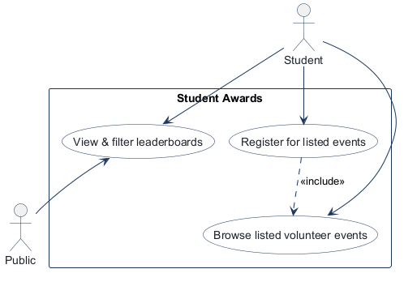
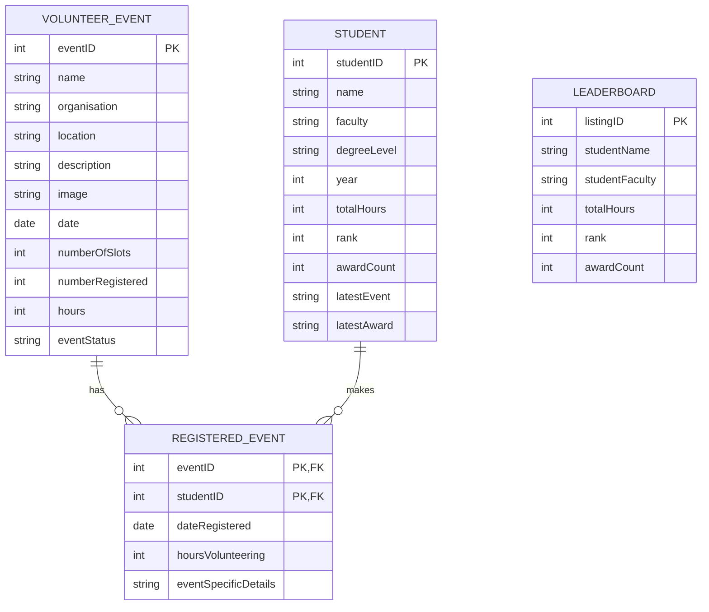
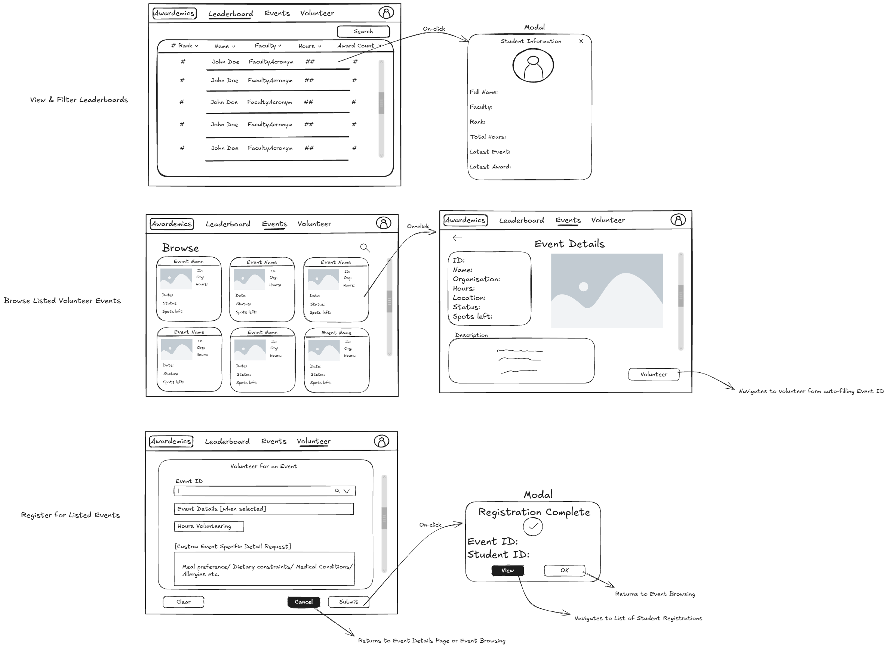

# COMP 3613 Assignment 1

Draft this file with the Guide. **Update it after every phase milestone** before you pause. The use-case diagram is a UML PNG at `docs/diagrams/use-case.png`, linked from this file as `diagrams/use-case.png` (path relative to `docs/report.md`). The model diagram is Mermaid. **Embed wireframe images** as `wireframes/<file>` (files live in `docs/wireframes/`).

Do not put your student ID in this file if you will commit it. The PDF cover adds your name and ID at export time.

## Assigned project

Student Awards (incentive system)

## Three workflows

### 1.

Browse listed volunteer events (Student)

### 2.

Register for listed events (Student)

### 3.

View & filter leaderboards (Public)

## Use case diagram

Phase 2 decisions: `Register for listed events` «includes» `Browse listed volunteer events`. `View & filter leaderboards` is shared by the Student and Public actors. Authentication is treated as an existing system assumption rather than a use case in this draft.

## Model diagram

Phase 3 first draft. `VolunteerEvent` and `Student` are many-to-many through
`RegisteredEvent`. A student may register for an event only once, so the
`eventID` and `studentID` pair is unique. Event capacity is enforced using
`numberOfSlots` and `numberRegistered`; new registrations are rejected when
the event is full. `eventStatus` belongs to `VolunteerEvent` and uses the
states `upcoming`, `ongoing`, and `completed`. `Leaderboard` is a derived
listing from student totals and rank, so it has no stored relationship or
foreign key to `Student`.

## Wireframes

### Student Awards workflows

<!-- student-build:wireframe-coverage
use_case: Browse listed volunteer events
image: docs/wireframes/wireframe.excalidraw.png
covered: yes
-->

<!-- student-build:wireframe-coverage
use_case: Register for listed events
image: docs/wireframes/wireframe.excalidraw.png
covered: yes
-->

<!-- student-build:wireframe-coverage
use_case: View & filter leaderboards
image: docs/wireframes/wireframe.excalidraw.png
covered: yes
-->

Phase 4 coverage: the composite wireframe covers event browsing and event details,
registration and confirmation, and leaderboard filtering with student details. The
registration path is complete through the confirmation modal; the leaderboard path
is complete through the student-information modal.

Accepted model revisions from the wireframe:

- `VolunteerEvent.organisation`, `location`, `description`, and `image` — shown on
  the event cards and event-details screen.
- `Student.awardCount`, `latestEvent`, and `latestAward` — shown in the leaderboard
  table and student-information modal.
- `RegisteredEvent.hoursVolunteering` and `eventSpecificDetails` — shown on the
  volunteer registration form.
- `Leaderboard.awardCount` — shown as a leaderboard column.

The wireframe uses one composite image for all three workflows, so no redraw is
needed. The `Volunteer` action is treated as the transition into the registration
workflow, with the event ID prefilled as shown.

## Theming

- Colors: Azure Mist (`#EDF7F6`) background, Baltic Blue (`#2660A4`) main
  colour, and Sandy Brown (`#F19953`) accent.
- Type: Montserrat for headings and the Awardemics wordmark; Liberation Sans
  for regular text.
- Tone: uplifting, proud, encouraging, and community-driven.
- Logo / wordmark: Awardemics.
- Applied to the landing, login, register, and authenticated shell through
  shared CSS brand tokens and templates.

## Implementation notes

One named workflow at a time. Include verify notes and polish / model revisions (Phase 5). Do not treat the first build as final.

### Browse listed volunteer events (Student)

- Chosen route shape: authenticated app home with event cards and an event-details
  modal.
- Added `VolunteerEvent` SQLModel fields from the ERD, plus repository/service
  abstractions for the ordered event list.
- Added Awardemics event cards, empty-state handling, and event-details modal
  with the wireframe's metadata and Volunteer action.
- Verify note: student ran the app and confirmed the cards and details modal
  matched the Browse wireframe.
- Polish: added service/repository-backed search by event name, location, or
  organisation, with clear and no-match states.
- Further polish requested after verification: converted search to an icon
  action aligned beside the right-aligned search field, shortened the sidebar,
  increased active nav-pill opacity and link weight, and changed logout text
  to the Sandy Brown accent for contrast.
- Final shell polish in progress: the sidebar remains normal document flow while
  filling the viewport, and logout hover uses Azure Mist with red text.
- Final shell adjustment: moved Logout beside the welcome message in the top
  bar and changed its hover state to Baltic Blue with white text.
- Verify note: student confirmed the sidebar scrolling, search alignment, nav
  emphasis, and top-bar Logout polish.

### Register for listed events (Student)

- Chosen route shape: dedicated registration route with the selected event ID
  carried in the URL.
- Added the `RegisteredEvent` composite key and ERD fields, the `Student` table
  required by the relationship, and repository/service-backed registration.
- Added the wireframe's volunteer form and registration-complete confirmation.
- Verify note: student confirmed the prefilled registration form and confirmation
  matched the wireframe.
- Polish: capped entered hours at the selected event's listed hours with both
  browser and service validation, and added a Volunteer item to the sidebar for
  manual form access.
- Verify note: student confirmed event lookup by ID/name, event details, Clear,
  and max-hours validation.
- Model/workflow revision: registration now rejects duplicate student/event
  pairs, rejects full events, and increments `numberRegistered` for a valid
  registration so spots left decreases.
- Polish: duplicate, full-event, and invalid-hours rejection now returns to the
  form with a dismissible modal while preserving the selected event and inputs.
- Polish: Clear now returns to a fresh Volunteer form, removing the selected
  event and any prior rejection state.
- Verify note: student confirmed Clear resets the whole form after a rejected
  duplicate registration.

### View & filter leaderboards (Public)

- Chosen route shape: public leaderboard page with filters and a
  student-information modal.
- Added the Student model fields from the ERD, service/repository-backed name
  and faculty filtering, a public table, student-information modal, and a
  landing-page Leaderboard link.
- Verify note: student confirmed unauthenticated leaderboard access.
- Model revision: seeded 100 Student records and linked the bob account to the
  first student profile; future registrations resolve through that account link.
- Polish: added ascending/descending header toggles that preserve active
  filters.
- Verify note: student confirmed 100 seeded students, correct filters, and
  ascending/descending header toggles.
- Final leaderboard polish: header hover text uses Sandy Brown and a Clear
  filters action resets the current leaderboard view.
- Final filter polish: Faculty is now a data-backed dropdown instead of a free
  text field.
- Final navigation polish: added Leaderboard to the authenticated sidebar.
- Registered-events polish: added Unregister to each registered-event card;
  unregistering removes the signed-in student's registration and restores one
  available event spot.
- Added Registered events to the authenticated navigation shown on the
  leaderboard page.
- UI polish: moved the authenticated welcome text after Registered events and
  styled it with Sandy Brown plus white hover text.
- Safety polish: Unregister now requires confirmation in a dismissible modal
  before its POST action commits.
- UI polish: removed welcome-text hover behavior and added View event buttons
  with event-details modals to registered-event cards.
- Additional Phase 5 polish: volunteer lookup is a regular search bar with
  listed results and event IDs; event details show Event ID; event-specific
  details input was removed; authenticated navigation wordmarks are clickable;
  and a volunteer favicon was added. The leaderboard header and original
  Montserrat typography were retained after verification.
- Final context polish: authenticated visitors see their welcome text and
  Events, Volunteer, and Logout links on the leaderboard; public visitors keep
  unauthenticated access with Sign in.
- Correction: added an authenticated Registered events navigation entry and
  student-scoped registered-events page showing each registration with event
  details, hours, date, and submitted details.
- Registration confirmation now includes a View registered events button.

<!-- student-build:code-check
workflow: View & filter leaderboards
form: snippet
layer: model
architecture_ok: yes
implement_confidence: 0.75
passed: yes
note: Student confirmed Student fields used by the ERD and leaderboard modal.
-->

<!-- student-build:code-check
workflow: View & filter leaderboards
form: snippet
layer: router
architecture_ok: yes
implement_confidence: 0.75
passed: yes
note: Student confirmed the route delegates to LeaderboardService without query logic.
-->

<!-- student-build:code-check
workflow: Register for listed events
form: snippet
layer: model
architecture_ok: yes
implement_confidence: 0.75
passed: yes
note: Student completed the composite eventID/studentID key and ERD registration fields.
-->

<!-- student-build:code-check
workflow: Register for listed events
form: snippet
layer: router
architecture_ok: yes
implement_confidence: 0.75
passed: yes
note: Student confirmed the POST handler delegates through RegisteredEventService without persistence logic.
-->
- Updated the CLI seed path to create ten upcoming demo volunteer events
  idempotently alongside the demo users.

<!-- student-build:code-check
workflow: Browse listed volunteer events
form: snippet
layer: model
architecture_ok: yes
implement_confidence: 0.75
passed: yes
note: Student completed VolunteerEvent fields from the ERD.
-->

<!-- student-build:code-check
workflow: Browse listed volunteer events
form: snippet
layer: router
architecture_ok: no
implement_confidence: 0.45
passed: no
note: First route attempt used select()/db.exec() in the router.
-->

<!-- student-build:code-check
workflow: Browse listed volunteer events
form: snippet
layer: router
architecture_ok: yes
implement_confidence: 0.60
passed: yes
note: Student rewrote the route to construct the repository/service and call browse_events().
-->

## Deployed app

Phase 6. Public Render URL (not localhost). Markers open this to mark the three workflows.

https://

## Logins

Every account a marker needs, including extra users you added. Starter accounts:

- bob / bobpass — regular user
- admin / adminpass — admin

## YouTube URL

## Session transcripts

Filled when the Guide builds the report: the agent writes each Guide chat to `docs/transcripts/<slug>.md` (Copilot Agent, Cursor, or OpenCode). `python manage.py report` packages them. Do not paste chats here during the build.

## Competency (student-judge)

Filled when the report is built. Guide runs student-judge, writes `docs/judge.md`, and export appends the scorecard here.

## Skill integrity

Filled by `python manage.py report`. Do not edit the course skills.
